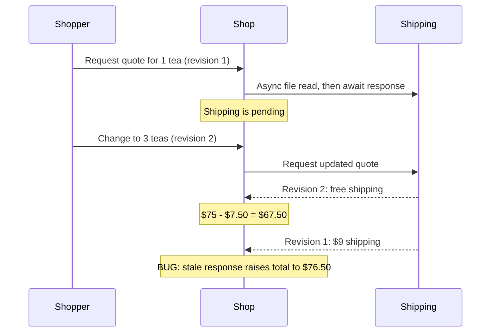

# Shop: reproduce an async production incident

The shop saves its cart and shipping source through `Ranvier.Persistence`. Its input journal records
cart edits and async outcomes in an **untraced Release** process. A fresh **traced Debug** process restores
the checkpoint and replays those inputs, producing the same checkout transitions without calling the gateway.

## Run it

From the repository root, choose a capture directory that does not exist:

```shell
dotnet run --project src/Ranvier.Examples.ShopReplay -c Release -p:RanvierTrace=false -- capture tmp/shop-incident
dotnet run --project src/Ranvier.Examples.ShopReplay -c Debug -p:RanvierTrace=true -- replay tmp/shop-incident
```

The shop prices tea at $25 per unit, applies `SAVE10`, checks stock, and offers free shipping above $50.
The scenario intentionally holds two asynchronous shipping requests so the older response arrives last:



This is an application race demonstrated in a production build. The development build executes the same
faulty application code; the example does not introduce a different bug with conditional compilation.
The local gateway reads [shipping rules](../../samples/shop/rates.json) with `File.ReadAllTextAsync` and
awaits per-request gates. The gates stage the incident reliably instead of relying on a lucky delay.

Both commands print the same five observations:

```text
cart=0 quote=-1 pending subtotal=2500 discount=250 shipping=0 total=2250
cart=1 quote=-1 pending subtotal=2500 discount=250 shipping=0 total=2250
cart=2 quote=-1 pending subtotal=7500 discount=750 shipping=0 total=6750
cart=2 quote=2 ready subtotal=7500 discount=750 shipping=0 total=6750
cart=2 quote=1 ready subtotal=7500 discount=750 shipping=900 total=7650
```

Replay fails if any observation differs. Its final message confirms `live calls=0` and `tracing=true`.
You can run replay repeatedly against the same capture.

## What gets saved

The capture directory contains:

- `checkpoint/`: the acknowledged cart snapshot and journal position, taken before async requests start.
- `live/`: the production session's current persisted state after the incident.
- `journal.jsonl`: the original input sequence, including async results and flush boundaries.
- `capture.json`: the expected customer-visible transitions and the producer's build mode.

Replay copies `checkpoint/` into a fresh temporary store. `Persist.replay ReplayMode.Diagnostic` applies
the journal tail after the saved position. The original checkpoint remains unchanged, and the live store
is not used as a replay starting point.

The matching graph starts with a pending `AsyncSource`. The cart edits re-run the quote-request effect;
`Journal.work` captures its attribution before the gateway would start. During diagnostic replay,
`Journal.replaying` suppresses that call. The journal supplies the recorded `Settle` or `Fail` instead.

Pending is reconstructed by the graph and checkpoint; it is not a sleep read from the journal.
Completion order and flush boundaries reproduce the observable sequence. Elapsed network time is irrelevant
to this incident. If application logic depends on time or randomness, expose and record those inputs too.

## Inspect the explanation

Replay writes three files beside the recording:

- `replay-why.txt`: `Trace.why` for the receipt's last run, connecting the older shipping result to the receipt.
- `replay-snapshot.txt`: the labelled graph, including `subtotal`, `discount`, `checkout` and `receipt`.
- `replay-trace.jsonl`: the development trace for further inspection.

The intentional defect is the unconditional `quote.Settle result` in
[Shop.fs](../../src/Ranvier.Examples.ShopReplay/Shop.fs). A production fix must accept a response only for
the current cart revision. Keep the faulty version when following this walkthrough: the demonstration
asserts the stale-response incident, and a corrected build should fail that incident assertion.

## Replay a failure too

```shell
dotnet run --project src/Ranvier.Examples.ShopReplay -c Release -p:RanvierTrace=false -- capture-failure tmp/shop-failure
dotnet run --project src/Ranvier.Examples.ShopReplay -c Debug -p:RanvierTrace=true -- replay tmp/shop-failure
```

The older request now fails after the newer quote succeeds. Replay reproduces
`failed:Shipping service unavailable`. It compares the observable failure message; a replayed failure
uses Ranvier's `JournalReplayedFailure`, rather than reconstructing the original exception instance.

## Verify the whole path

```shell
python tools/verify-shop-replay.py
```

The check builds both variants, captures to disk, launches three independent replay processes and compares
their trace files byte for byte. It also checks failure replay, checkpoint immutability and rejection of
wrong build modes, an existing capture directory, damaged journals, incompatible codecs, changed expected
observations and a missing checkpoint. CI runs this check.

The sample JSONL sink is an application implementation of `IInputJournal`, with explicit schema mapping
and file flushes. It is a small single-process demonstration, not a distributed snapshot/journal
transaction. The checkpoint is taken after `FlushAsync` while the graph is quiescent; it contains no
in-flight work. Keep matching code, stable keys and compatible codecs when replaying a captured session.
